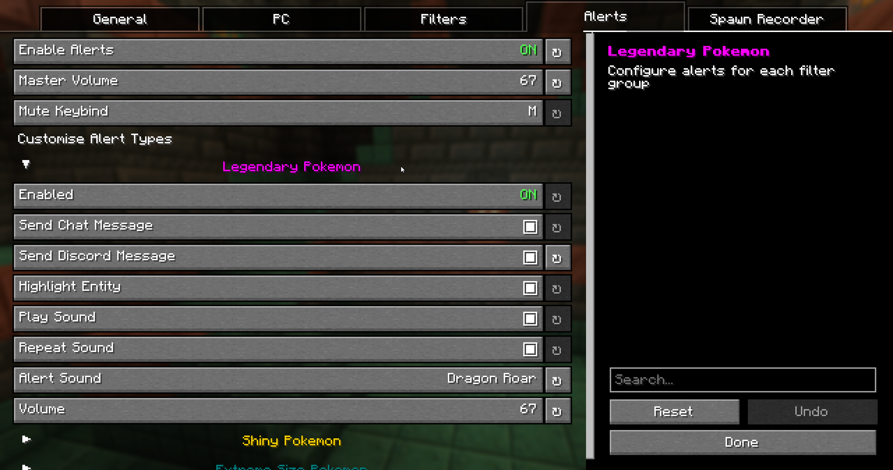
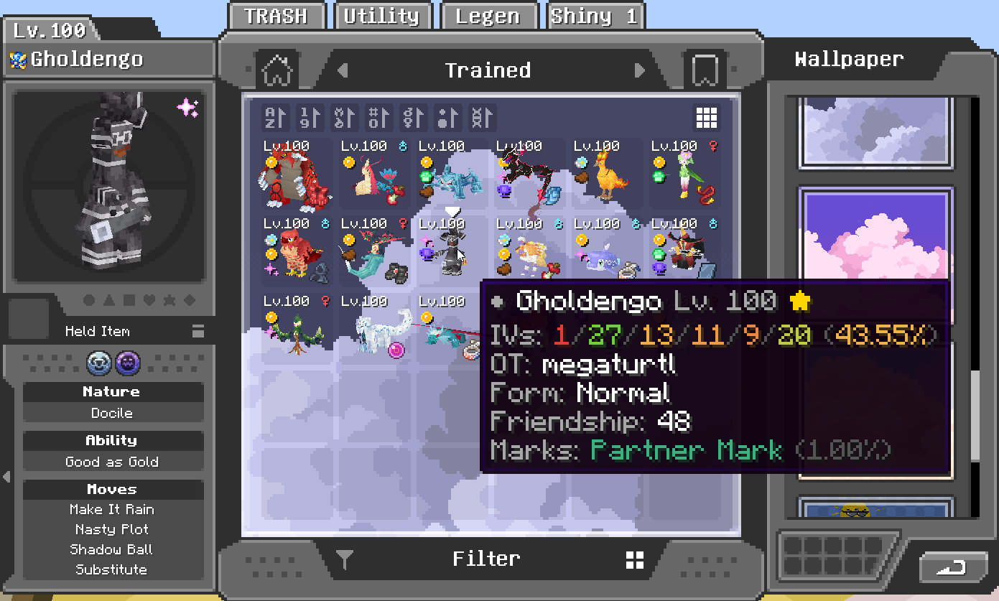
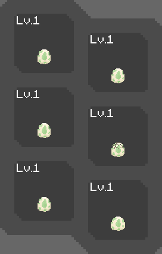
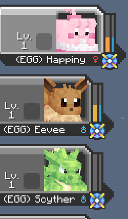
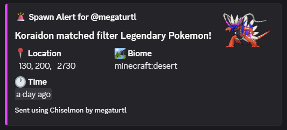
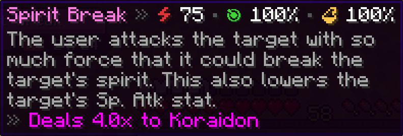
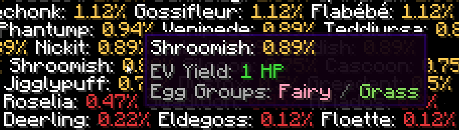
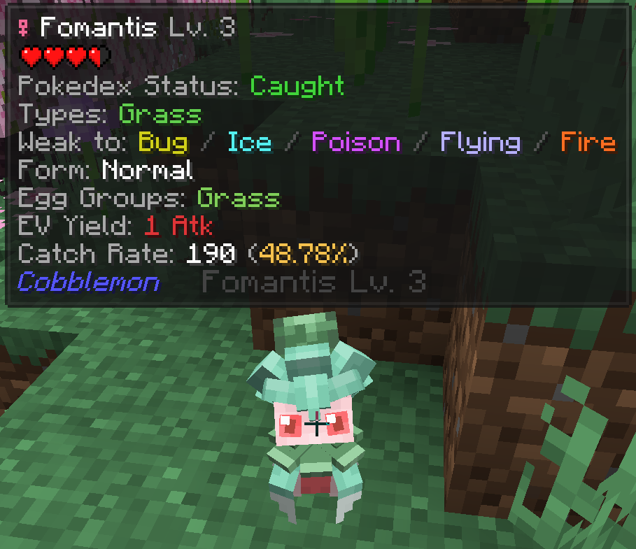
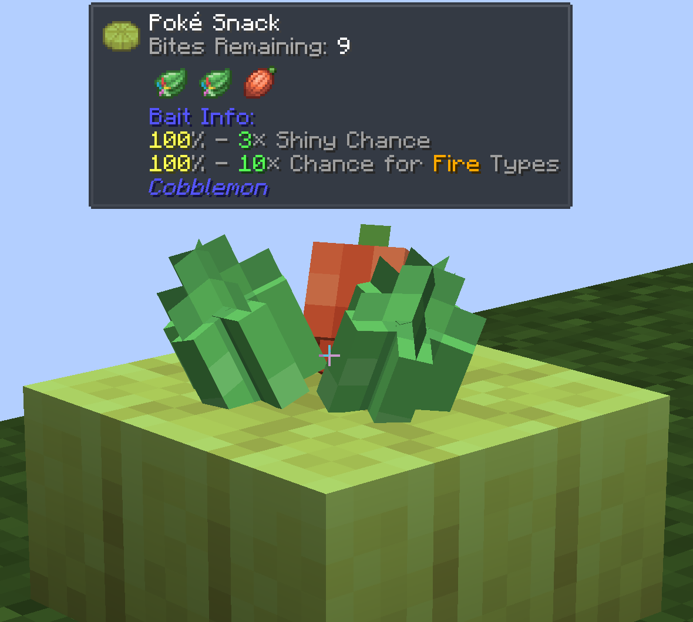

# Chiselmon


[](https://modrinth.com/mod/chiselmon)
[](https://www.curseforge.com/minecraft/mc-mods/chiselmon)
[](https://discord.gg/wFRFqQK9WW)
<br>


Sculpt your perfect Cobblemon experience with deeply customisable QOL tweaks!

## Installation

Chiselmon is a fully client side Cobblemon sidemod for Fabric and NeoForge.

To use Chiselmon, make sure you have Cobblemon 1.7.0+ and [Yet Another Config Lib](https://modrinth.com/mod/yacl) installed. To get the most out of the mod, consider also installing [Jade](https://modrinth.com/mod/jade).

## Customising Your Tweaks

If you haven't used Chiselmon before, I recommend exploring the config options beforehand so you can see what features are available.


You can open the Chiselmon config in 3 ways:

1. Click the Chiselmon icon in your mod menu.
2. Use the `/ch config` command in-game.
3. Press the hotkey. The default is `;`, but this can be changed in the config.

### Disabling Chiselmon

General → **Disable Mod** suspends alerts, new encounter recording, recorder updates, and Chiselmon's visual additions without deleting saved data. Configuration and lifecycle cleanup remain available. Installed resource packs and saved PC customizations are not removed.

An active recorder keeps its totals and manual pause state while its active-session timer is frozen. Reenabling does not retrospectively count Pokémon loaded while disabled.

An open dashboard stops listening while disabled and resumes when Chiselmon is reenabled. Closing it with `/ch dash close` or leaving the world cancels that resume. If reopening fails, the dashboard stays stopped and logs the error; resolve the cause before using `/ch dash open`.

Queued Discord sends check the switch before opening a connection. Requests that have already started can still complete.

The PokeRod replacement follows the loader's HUD layout. With either toggle off, the normal timed item label is left intact, including custom names.

### Saved data safety

Chiselmon saves JSON data through a temporary sibling file and atomic replacement, rather than truncating the existing file. If serialization or replacement fails, the previous file remains intact and unsaved edits remain cached while the client is running. Resolve the reported problem before exiting to avoid losing those unsaved edits. Filesystems without atomic replacement fail the save rather than use an unsafe fallback.

Corrupt or empty JSON is moved to a `.bak` file before defaults are used. If that backup cannot be created, including because a previous `.bak` already exists, loading fails without deleting or overwriting either copy. With Minecraft closed, preserve the existing backup under another name and resolve the reported filesystem problem before retrying.

On world leave and game exit, Chiselmon stops dashboard requests before flushing and closing their encounter database. Successful disposal releases the database files, and saved history remains available on reconnect. If persistence fails, the affected cached data is retained for retry while other stores continue cleanup. Bulk persistence reports the first failure with later distinct failures attached as suppressed exceptions, so errors from other failed scopes are not lost.

## Features

### PC Overhaul:



- **Bookmark up to 5 boxes** and jump to them at any time.
- **10 new wallpapers**. Hold `Ctrl` while choosing to apply a selected wallpaper to every box at once.
- **Quick-sort any box**. Default hotkey is `Middle-Click`.
- **6 unique icons** to easily identify special pokemon (shiny, high IVs, hidden ability, extreme size, marks, rideable).
- **Detailed tooltips** showing IVs, original trainer, form, friendship, ride styles, marks, and egg hatch progress.
- **2 new box sorting modes**. Sort by Pokemon size and total IVs.

### Egg Spy:




- Use Chiselmon's cutting edge ultrasound technology to preview what's inside pokemon eggs (NeoDaycare only).
- Optionally replaces the HP and XP bar of eggs in your party overlay with their hatch progress so you can easily keep track while hatching.

### Spawn Alerts:



- Alert system for legendaries, shinies, alphas, uncaught pokemon, size variations, or any other custom chosen pokemon that spawn around you.
- Create unlimited custom filters to receive alerts for with Chiselmon's logic building system.
- 4 Fully configurable alert types per filter - chat messages, Discord webhook messages, sounds, colored highlights.
- Mute all active alert sounds with the 'M' keybind (configurable in Minecraft controls and Chiselmon config).
- Create server/world specific exclusion zones to suppress alerts (e.g. at spawn, hubs, or pasture areas).

### Spawn Recorder:

- Records total pokemon spawns and the number of each species in the current session.
- Use the `/ch record start, stop, pause, and resume` commands to manage your session.
- Optional action bar display: shows the total spawns and time passed since starting, and the number of currently loaded pokemon + how many are old enough to start despawning.
- Optional despawn glow: highlights loaded pokemon in green, turning red when they're ready to despawn.

### Misc:

#### Move Tooltips



#### /checkspawn Improvemennts


`/checkspawn` results now have hoverable tooltips showing egg group and EV yield info to make cake hunting easier.

### Jade Addons:

#### Pokemon Extra Info



- Types
- Weaknesses
- Form
- Pokedex status
- Egg groups
- EV yield
- Catch rate
- Catch chance % (when holding a Pokeball - considers level, status, etc!)
- Warnings for self-damaging moves - never lose a shiny to explosion again! </3

#### Poke Snack Extra Info:



- Bites remaining
- Ingredients
- Seasoning effects

---

# Development Info

## Development environment

On Linux x86-64, install Nix with the `nix-command` and `flakes` features enabled, then enter the pinned development shell:

```bash
nix develop
./gradlew build
./gradlew :fabric:runClient
./gradlew :neoforge:runClient
```

The shell provides Java 21, Git, Node.js for `node dev-server.mjs`, and the configured `treefmt` wrapper. Use the Gradle wrapper rather than a separately installed Gradle.

The Kotlin compiler and loader runtime have separate versions in `gradle/libs.versions.toml`. `kotlin-runtime` sets the standard library and language/API baseline, which also controls emitted metadata. Keep that baseline compatible with Fabric Language Kotlin and Kotlin for Forge when upgrading build tooling.

On NixOS, the shell makes the GL, PulseAudio, ALSA, and narrator libraries available to Minecraft's bundled natives and exposes `/run/opengl-driver/lib` for the host GPU. The graphics driver and audio server are not pinned by the flake. Other Linux hosts may need their own graphics integration.

For IntelliJ IDEA, import the Gradle project using its wrapper and set the Gradle JVM to the Java 21 path printed by `echo "$JAVA_HOME"` inside `nix develop`, or start the IDE from that shell.

The flake locks dev tools but not Gradle's downloaded Minecraft, plugins, or mod dependencies. Gradle keeps its writable cache in the usual user directory and needs network access for missing artifacts.

After changing a flake input, run `nix flake lock` and commit `flake.nix` and `flake.lock` together. CI uses `--no-update-lock-file` and rejects inputs that do not match the committed lockfile.

## Formatting

Run `nix fmt`, or `treefmt` inside `nix develop`, to format source files. Use `nix fmt -- --ci` to fail when a formatting pass changes files, or `nix flake check --no-update-lock-file` to run the formatting check in a sandbox.

`treefmt.nix` enables Alejandra for Nix; ktfmt for Kotlin and Gradle Kotlin DSL; google-java-format for Java; Prettier for JavaScript, HTML, CSS, JSON (including Minecraft `.mcmeta` files), YAML, and Markdown; and Taplo for TOML. Kotlin and Java use four-space indentation and remove unused imports automatically.

Generated Gradle wrappers, lockfiles, build/runtime outputs, and Pebble Kotlin templates are excluded. Plain `.properties` files, access wideners, and binary assets have no configured formatter and remain unchanged.

## Client feature ownership

`ChiselmonClientCommon` owns the shared client tick pipeline: world teardown, species indexing, storage autosave, tracking, alerts, then the spawn recorder. Keep these feature ticks in that pipeline rather than registering separate tick listeners, so teardown always runs first. The configuration hotkey has an independent UI listener.

`PCScreenFeatures` owns bookmark/sort widgets, disable/reenable cleanup, and PC settings persistence. `MixinPCGUI` owns the Cobblemon field access, injection points, and egg-preview rendering adapters. Screen initialization and resizing create a fresh feature owner; screen removal also saves PC settings.

## Versioning

The release version is derived from two properties in `gradle.properties`:

```properties
chiselmon_version = 1.4.1
cobblemon_version = 1.8.0
```

These properties would produce `1.4.1+cobblemon-1.8.0`. Local and tagged builds use this clean string, but extra build metadata is added for development jars.

| Context         | Example version                        |
| --------------- | -------------------------------------- |
| Local build     | `1.4.1+cobblemon-1.8.0`                |
| Merge to `main` | `1.4.1+cobblemon-1.8.0.commit.a3f92c1` |
| Pull request    | `1.4.1+cobblemon-1.8.0.pr42.a3f92c1`   |
| Tagged release  | `1.4.1+cobblemon-1.8.0`                |

## Build workflows

`build-pull-request` verifies every pull request and uploads testable mod artifacts. `build-commit` verifies maintained branches and keeps the gradle cache warm. `build-tag` builds the official release under the `prod` environment.

## Creating a release

1. Update release properties in `gradle.properties` and merge the release commit to the main branch.
2. Create and push the exact configured tag:
   ```bash
   version=$(./gradlew --quiet printVersion)
   git tag "v$version"
   git push origin "v$version"
   ```
3. `build-tag` verifies the tag, builds both jars, creates or updates the GitHub Release, and attaches the Fabric and NeoForge jars. GitHub generates a default changelog from the previous release, which can be edited afterward if need be.

To build Fabric and NeoForge jars locally, run `./gradlew build`. The outputs will be saved to `{loader directory}/build/libs`.
